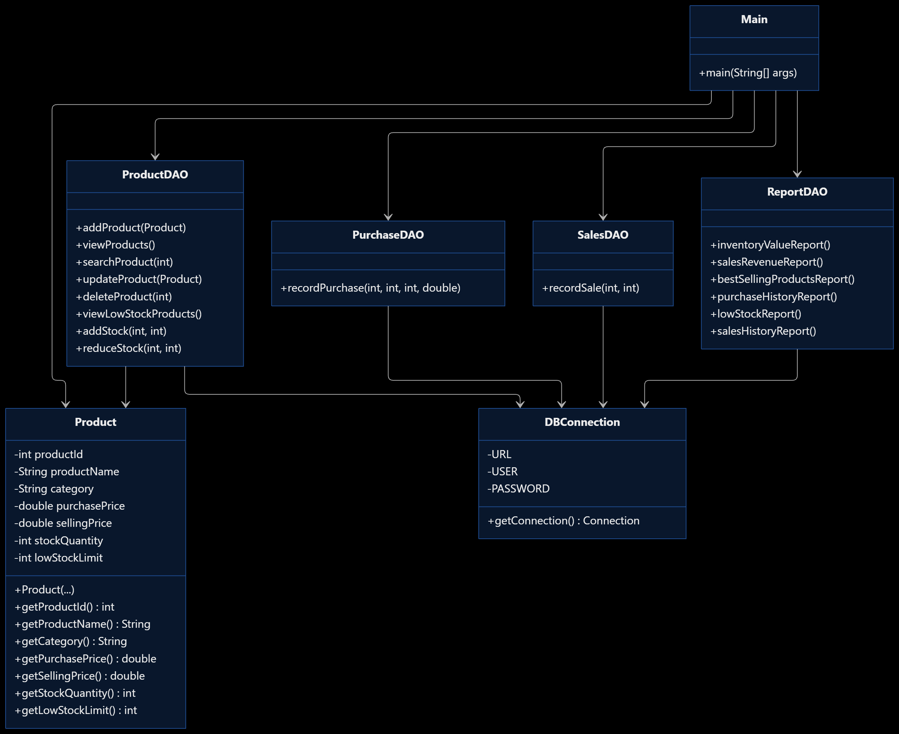
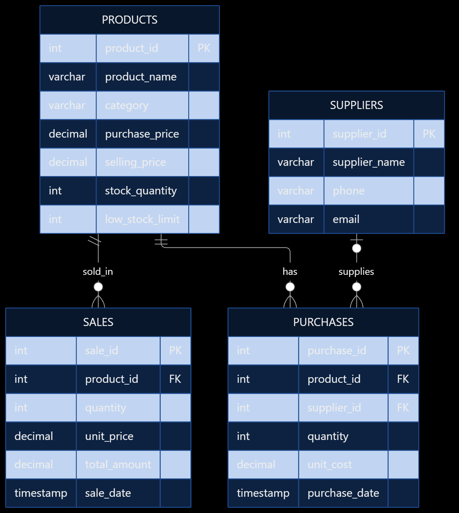

# 📦 Inventory Management System

A Java-based desktop application for managing inventory, tracking stock, recording purchases and sales, and analyzing business performance. Built using **Java Swing, JDBC, and MySQL**, this project provides a graphical interface for common inventory management operations.

[](https://www.oracle.com/java/)
[](https://www.mysql.com/)
[](https://docs.oracle.com/javase/tutorial/uiswing/)
[](#license)

---

## 📑 Table of Contents

- [Project Overview](#-project-overview)
- [Features](#-features)
- [Technology Stack](#-technology-stack)
- [Project Structure](#-project-structure)
- [Database Design](#-database-design)
- [Prerequisites](#-prerequisites)
- [Getting Started](#-getting-started)
- [Database Configuration](#-database-configuration)
- [Compile and Run](#-compile-and-run)
- [Building the Windows Installer](#-building-the-windows-installer)
- [How to Use](#-how-to-use)
- [Team Collaboration](#-team-collaboration)
- [Troubleshooting](#-troubleshooting)
- [Future Improvements](#-future-improvements)
- [Contributing](#-contributing)
- [License](#-license)

## 📌 Project Overview

The Inventory Management System is a desktop application designed to simplify inventory operations for small businesses, stores, and academic demonstrations.

It connects a Java Swing graphical user interface to a MySQL database using JDBC. Users can manage products, monitor available stock, record purchases and sales, and generate reports for inventory and sales analysis.

The project demonstrates practical applications of object-oriented programming, relational database management, SQL queries, transaction handling, and graphical user interface development.

## 📐 System Design

### UML Class Diagram

The UML class diagram illustrates the application's main classes, their responsibilities, methods, and relationships. It highlights the interaction between the product model, data access objects (DAOs), and database connection.



### Entity-Relationship (ER) Diagram

The ER diagram represents the four main database entities: `PRODUCTS`, `SUPPLIERS`, `PURCHASES`, and `SALES`. It shows their attributes, primary keys, foreign keys, and relationships.



For the complete database table definitions, see [`database/schema.sql`](database/schema.sql).

## ✨ Features

### 1. Dashboard
- View inventory value.
- Monitor sales revenue.
- Identify products requiring stock replenishment.
- Access the main application modules.

### 2. Product Management
- Add new products.
- Update product details.
- Delete products.
- Search products by ID or name.
- Filter products by category.
- View product information in a table.

### 3. Stock Management
- Increase or decrease stock quantities.
- Monitor available inventory.
- Identify products below their configured low-stock threshold.

### 4. Purchase Management
- Record product purchases.
- Associate purchases with suppliers.
- Store purchase quantities, unit costs, and dates.
- Update stock following successful purchases.

### 5. Sales Management
- Record product sales.
- Check stock availability before selling.
- Calculate sale totals.
- Reduce inventory after successful sales.

### 6. Reports and Analytics
- Inventory valuation.
- Sales revenue reports.
- Best-selling products.
- Purchase history.
- Sales history.
- Low-stock reports.
- Profit analysis and product-wise profit reports.
- Date-filtered reports and CSV export.

### 7. Charts
- Daily revenue visualization.
- Best-selling product charts.
- Daily gross-profit visualization.
- Selectable reporting periods.

> **Note:** Profit analysis estimates cost of goods sold using the product's current purchase price. It may not represent exact historical profit when purchase costs change.

## 🛠️ Technology Stack

| Technology | Purpose |
|---|---|
| Java | Application logic and object-oriented programming |
| Java Swing | Desktop graphical user interface |
| JDBC | Java-to-MySQL connectivity |
| MySQL | Relational database |
| MySQL Connector/J | JDBC driver |
| Git | Version control |
| GitHub | Source-code hosting and collaboration |
| `jpackage` | Windows application packaging |

## 📁 Project Structure

```text
InventoryManagementSystem/
│
├── Main.java
├── DBConnection.java
├── Product.java
├── ProductDAO.java
├── PurchaseDAO.java
├── SalesDAO.java
├── ReportDAO.java
│
├── ProductPanel.java
├── StockPanel.java
├── PurchasePanel.java
├── SalesPanel.java
├── ReportPanel.java
├── DashboardPanel.java
├── ChartsPanel.java
│
├── lib/
│   └── mysql-connector-j-26.10.0.jar
│
├── db.properties.example
├── db.properties          # Local file; do not commit
├── .gitignore
├── README.md
├── manifest.txt
├── InventoryManagementSystem.ico
│
├── packaging/             # Local packaging files
└── dist/                  # Generated installer; do not commit
```

The `db.properties` file is created locally by each developer and should be excluded from Git. The example file documents the required database settings.

## 🗄️ Database Design

The application uses a MySQL database named `inventory_management`.

### Tables

| Table | Purpose |
|---|---|
| `products` | Product information, prices, stock quantities, and low-stock limits |
| `suppliers` | Supplier contact information |
| `purchases` | Purchase records, suppliers, quantities, costs, and dates |
| `sales` | Sales records, quantities, unit prices, totals, and dates |

### Main relationships

- A product can have multiple purchase records.
- A supplier can be associated with multiple purchases.
- A product can have multiple sales records.
- Purchases reference products and suppliers.
- Sales reference products.

The schema includes primary keys, foreign keys, validation constraints, and an index on product names.

**Database setup:** Create the `inventory_management` database and the required tables before launching the application. Use your project's SQL setup script if one is available. If the script is not included in the repository yet, add a sanitized `database/schema.sql` file containing the final table definitions and constraints.

Do not upload private production data or database passwords.

## 📋 Prerequisites

Before running the project, install:

1. **Java JDK 26** or a compatible JDK supported by your source code.
2. **MySQL Server**.
3. **MySQL Workbench** (optional, but useful for managing the database).
4. **Git**.
5. **Visual Studio Code** or another Java IDE.

The MySQL Connector/J driver is provided in the `lib` directory.

Verify your Java installation:

```powershell
java -version
javac -version
```

Verify Git:

```powershell
git --version
```

## 🚀 Getting Started

### 1. Clone the repository

Open PowerShell or the VS Code terminal and run:

```powershell
git clone https://github.com/SiddhantChauhann555/InventoryManagementSystem1.git
```

Navigate into the downloaded folder:

```powershell
cd InventoryManagementSystem1
```

Alternatively, open the repository page on GitHub and select **Code → Download ZIP**.

### 2. Open the project in VS Code

```powershell
code .
```

Make sure the Java source files and `lib` folder are present.

### 3. Configure the database

Start MySQL Server and create the required database and tables using your SQL schema.

Create your local configuration file as described in the next section.

## 🔐 Database Configuration

Database credentials must not be hardcoded into Java source files or uploaded to GitHub.

Create a file named `db.properties` in the project root:

```properties
db.url=jdbc:mysql://localhost:3306/inventory_management
db.username=YOUR_MYSQL_USERNAME
db.password=YOUR_MYSQL_PASSWORD
```

Replace the placeholders with your own local MySQL credentials.

If the repository contains `db.properties.example`, copy it:

```powershell
Copy-Item db.properties.example db.properties
```

Then edit `db.properties` with your credentials.

Ensure `.gitignore` contains:

```gitignore
db.properties
*.class
dist/
packaging/
```

The connection code in `DBConnection.java` must read these settings from the properties file.

**Important:** Every developer must configure their own MySQL connection and database. Never commit real passwords.

## ▶️ Compile and Run

From the project root, compile the application:

```powershell
javac -cp ".;lib\*" DBConnection.java Product.java ProductDAO.java PurchaseDAO.java SalesDAO.java ReportDAO.java ProductPanel.java StockPanel.java PurchasePanel.java SalesPanel.java ReportPanel.java DashboardPanel.java ChartsPanel.java Main.java
```

Run the application:

```powershell
java -cp ".;lib\*" Main
```

Make sure MySQL is running and the database is configured before launching the application.

## 🪟 Building the Windows Installer

A Windows installer can be generated with Java's `jpackage` utility.

Requirements:
- Windows.
- A compatible JDK with `jpackage`.
- WiX Toolset, when required by your JDK's Windows packaging configuration.
- A successfully compiled and tested application.

The existing packaging workflow uses the compiled application JAR, MySQL Connector/J, and the custom icon.

Example command:

```powershell
jpackage --type exe --name "Inventory Management System" --app-version 1.0.0 --input packaging\input --main-jar InventoryManagementSystem.jar --main-class Main --icon InventoryManagementSystem.ico --dest dist --win-menu --win-shortcut --win-per-user-install
```

The generated installer is placed in the `dist` directory.

**Note:** The application installer does not automatically install or configure MySQL Server or create the database. The target computer must have access to a correctly configured database.

## 🖥️ How to Use

### Dashboard
Open the application to view the dashboard and access the main modules.

### Products
Add products with their names, categories, purchase prices, selling prices, initial stock quantities, and low-stock limits. Search or filter the product list as needed.

### Stock Management
Use the stock module to increase or decrease available quantities and review low-stock products.

### Purchases
Select the product and supplier, enter the quantity and unit cost, and record the purchase. Verify that stock is updated.

### Sales
Select a product, enter the quantity and selling price as required by the interface, and record the sale. Ensure sufficient stock is available.

### Reports
Choose a report type to view inventory, purchases, sales, low-stock products, or profit analysis. Use date filters where available and export supported reports to CSV.

### Charts
Select a reporting period to view revenue, best-selling products, and gross-profit trends.

## 👥 Team Collaboration

This project is maintained using Git and GitHub.

### Get the latest changes

```powershell
git pull origin main
```

### Create a feature branch

```powershell
git switch -c feature/your-feature-name
```

### Commit your changes

```powershell
git add .
git commit -m "Describe your changes"
```

### Push your branch

```powershell
git push -u origin feature/your-feature-name
```

Then open a Pull Request on GitHub so the team can review the changes before merging them into `main`.

Avoid having multiple contributors edit the same files simultaneously. Test database-related changes before merging.

## 🧰 Troubleshooting

### Database connection fails
- Verify that MySQL Server is running.
- Confirm the database name, username, password, and port in `db.properties`.
- Verify that the required database tables exist.
- Confirm that MySQL Connector/J is available on the classpath.

### `ClassNotFoundException` or driver errors
Check that `lib/mysql-connector-j-26.10.0.jar` exists and that commands use `-cp ".;lib\*"` on Windows.

### `javac` is not recognized
Install a JDK and configure your Windows `PATH` so the JDK's `bin` directory is available.

### Products or reports are empty
Verify that the correct database is configured and contains the expected records. Check the application console for SQL errors.

### Git refuses to push
Run:

```powershell
git status
git remote -v
```

Confirm that the remote URL is correct and that you have permission to push to the repository.

## 🔮 Future Improvements

Possible future enhancements include:

- Role-based authentication and permissions.
- Invoice generation and product-return management.
- Barcode or QR-code support.
- Expiry-date and dead-stock alerts.
- Advanced customer-demand tracking.
- Improved historical profit calculations.
- Automated database backup and restore.
- Cross-platform application packaging.

These are potential improvements, not claims about the current implementation.

## 🤝 Contributing

Contributions, bug reports, and suggestions are welcome.

1. Fork or clone the repository.
2. Create a separate feature branch.
3. Make your changes.
4. Test the application and relevant database operations.
5. Commit your changes with a descriptive message.
6. Open a Pull Request for review.

Please do not commit credentials, private database records, or generated build files.

## 📄 License

No license has been specified yet. Unless a license is added, the project should not be assumed to permit unrestricted reuse or redistribution.

## 👨‍💻 Authors

Developed as a collaborative academic project by a team of Computer Science and Engineering students.

For questions, bug reports, or suggestions, please open an issue in the GitHub repository.

---

**Repository:** [InventoryManagementSystem1](https://github.com/SiddhantChauhann555/InventoryManagementSystem1)

If you find this project useful, consider starring the repository!
